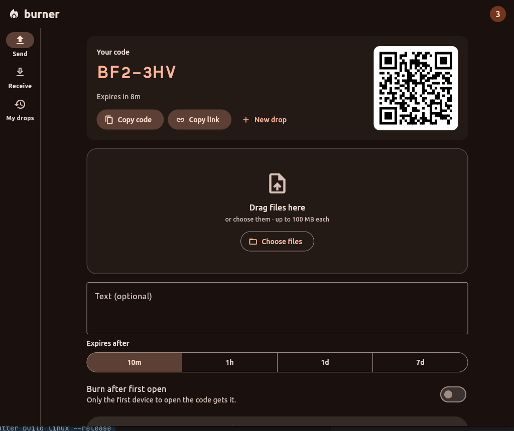
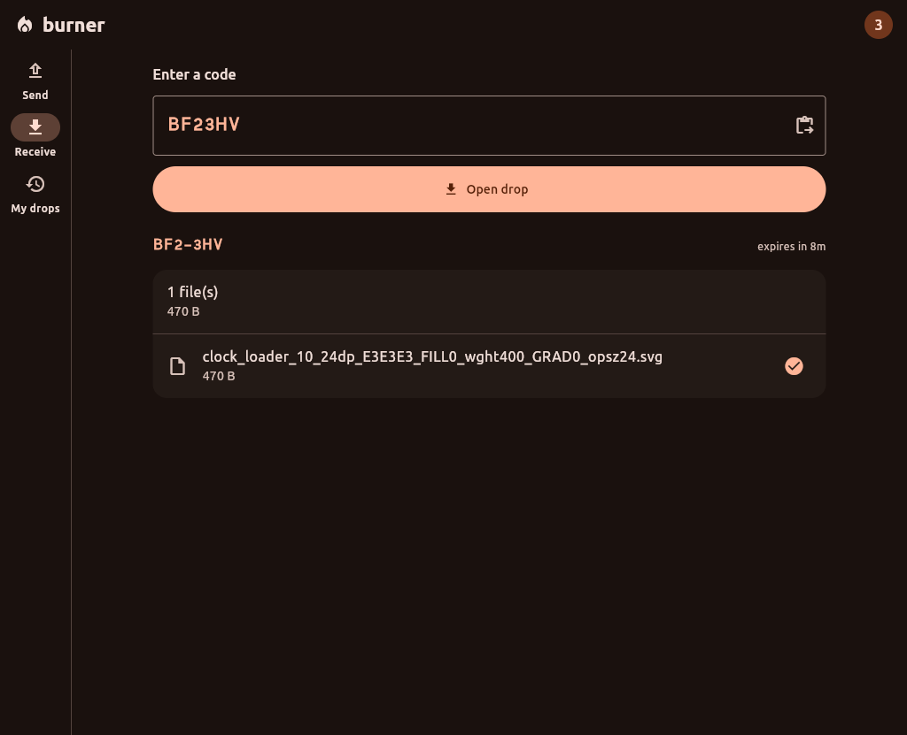
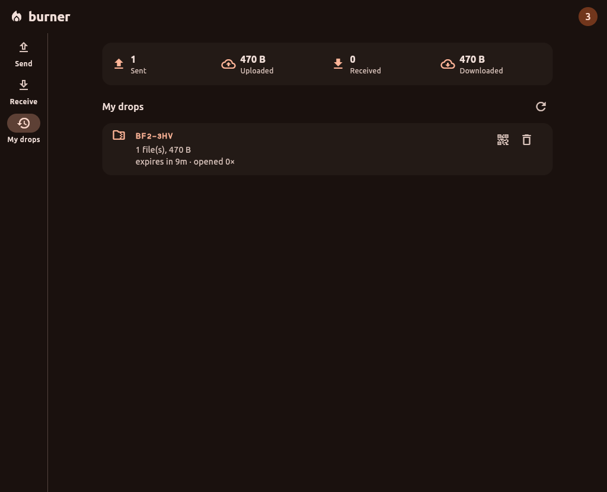
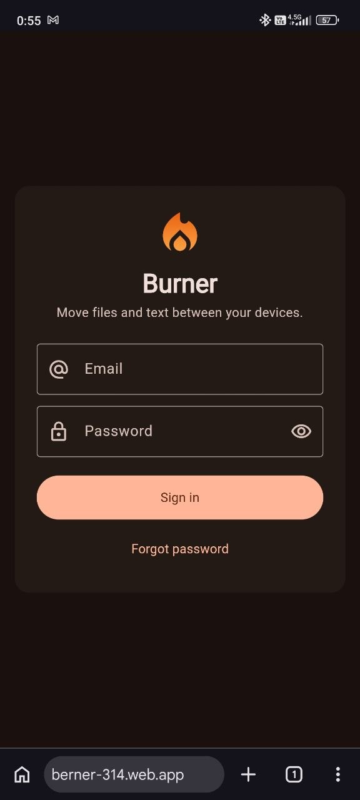
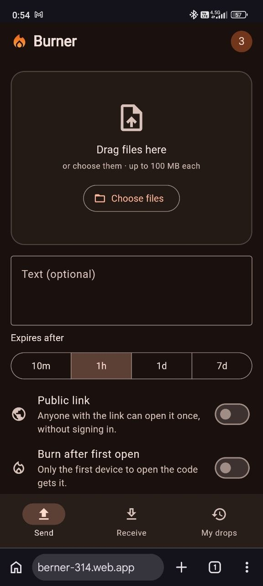
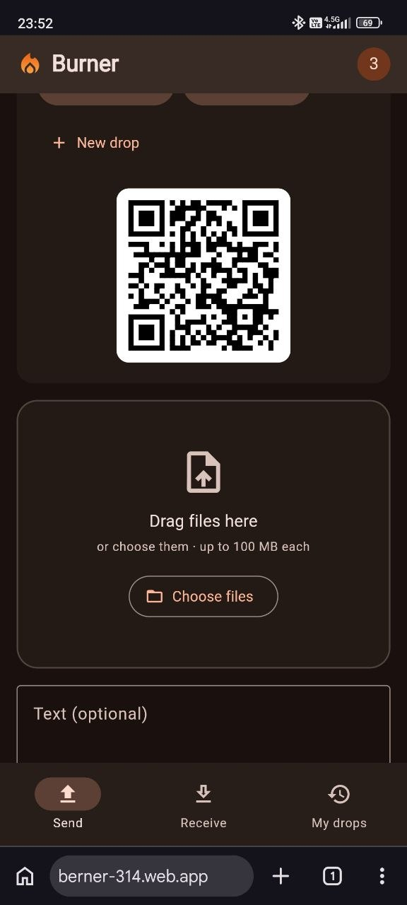
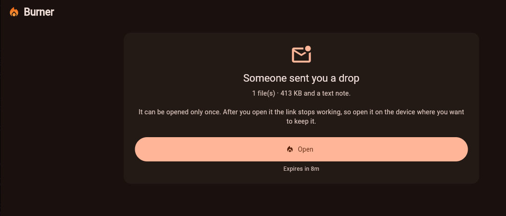

<div align="center">


# Burner

**AirDrop-style sharing for Ubuntu, the web and Android.**

Drop files or text in, get a short code, link or QR code, and pick it up on another device. Drops expire and can burn after the first open.

[](https://flutter.dev)
[](https://dart.dev)
[](https://firebase.google.com)
[](CHANGELOG.md)

[](#running)
[](https://berner-314.web.app)
[](#running)

</div>

---

Drag files (or paste text) into Burner, get a short code like `ABC-234`, a
link and a QR code, then open that code on another device to download
everything. You can also send a **public link** to someone who doesn't use
Burner: it opens in any browser without signing in and works once.

There's no server. The app talks to Firebase directly (Auth, Cloud Firestore,
Cloud Storage), and the security rules in this repo decide who can do what.

## Screenshots

### Desktop (Ubuntu and web)

<table>
  <tr>
    <td align="center"><br><sub><b>Send</b>: drop files, get a code and QR</sub></td>
    <td align="center"><br><sub><b>Receive</b>: enter the code, download</sub></td>
    <td align="center"><br><sub><b>My drops</b>: history and usage</sub></td>
  </tr>
</table>

### Mobile

<table>
  <tr>
    <td align="center"><br><sub><b>Sign in</b></sub></td>
    <td align="center"><br><sub><b>Send</b>: expiry, public link, burn</sub></td>
    <td align="center"><br><sub><b>Share</b>: scan the QR code</sub></td>
  </tr>
</table>

### Public link (no sign-in)

<p align="center">
  
</p>

## Features

- **Drag and drop** files onto the window (Linux desktop and web), or pick
  them with the file chooser (all platforms).
- **Text drops**: send a note, link or snippet, with or without files.
- **Code, link and QR**: the link opens the web app with the code already
  filled in.
- **Expiry**: 10 minutes, 1 hour, 24 hours or 7 days.
- **Burn after first open**: only the first device that opens the code gets it.
- **My drops**: your drops, their status and open count, plus usage totals
  (drops sent/received, bytes uploaded/downloaded).
- **Public links**: share with someone who doesn't use Burner. The link opens
  in any browser without signing in, works once, and burns when opened.
- **Signed-in users only** for everything else: without Firebase Auth, the only
  thing anyone can do is open a public link they were given.
- **Responsive**: a side rail on wide windows, a bottom bar on phones.

## How it works

```
 Device A (sender)                          Device B (receiver)
 ─────────────────                          ───────────────────
 1. upload files ─────► Cloud Storage
    drops/{uid}/{random}/…
 2. commit ───────────► Firestore            4. GET drops/{code} ◄── enters code
    drops/{code}  + users/{uid} usage        5. downloads +1 (burn if needed)
 3. show code / link / QR  ─ ─ ─ ─ ─ ─ ─ ►   6. download files ◄── Cloud Storage
```

Every request carries the user's Firebase ID token, so the rules in
[`firestore.rules`](firestore.rules) and [`storage.rules`](storage.rules) are
enforced on every call.

## Firebase setup

You need a Firebase project on the **Blaze** plan. Cloud Storage for Firebase
requires it for new buckets, and the free usage quotas still apply.

1. **Authentication** → Sign-in method → enable **Email/Password**.
2. **Firestore Database** → create a database (Native mode).
3. **Storage** → get started (this creates the default bucket).
4. **Project settings** → General → *Your apps* → add a **Web app**. Copy
   `apiKey`, `projectId` and `storageBucket`.
5. Create the app config:

   ```bash
   cp config/firebase.env.example.json config/firebase.env.json
   ```

   Fill in the values. `BURNER_WEB_URL` is where you host the web build
   (for example `https://<project-id>.web.app`). It's used for share links;
   leave it empty if you don't host the web app. Public links need it.
   `BURNER_SIGNUP_ENABLED` shows the "Create an account" button; it's
   `false` for now, so create accounts in the Firebase console
   (Authentication → Users → Add user). This file is gitignored.

6. Deploy the rules (needs the [Firebase CLI](https://firebase.google.com/docs/cli)):

   ```bash
   firebase login
   firebase use --add            # pick your project
   firebase deploy --only firestore:rules,storage
   ```

   Run this interactively (not with `--non-interactive`). The first time, it
   asks to grant Cloud Storage an IAM role so `storage.rules` can read
   Firestore. Answer **Y**, or public-link downloads fail with 403.

7. **Auto-delete expired data.** The app cleans up a user's expired drops when
   they open it. These two settings handle drops whose owner never comes back:

   ```bash
   # Firestore: delete drop documents once expiresAt has passed
   gcloud firestore fields ttls update expiresAt \
     --collection-group=drops --enable-ttl --project=<project-id>

   # Storage: delete uploaded files older than 8 days (max expiry is 7)
   gcloud storage buckets update gs://<bucket> --lifecycle-file=storage-lifecycle.json
   ```

8. **Web downloads need CORS** on the bucket. This step is required: without
   it, downloads in the browser fail with "No 'Access-Control-Allow-Origin'
   header". Error responses carry that header anyway, so a quick check can
   look fine before this is set.

   ```bash
   gcloud storage buckets update gs://<bucket> --cors-file=storage-cors.json
   ```

   No `gcloud` locally? Open [Cloud Shell](https://shell.cloud.google.com/),
   upload `storage-cors.json` or paste its contents into a file, and run the
   same command. You can replace `"*"` in `storage-cors.json` with your
   hosting origin(s), but keep a `localhost` origin if you use
   `flutter run -d chrome`.

> **API key restrictions:** if you restrict the Web API key in Google Cloud
> Console, the Linux and Android builds call the same REST APIs without a
> browser referrer. Either leave application restrictions off (API
> restrictions to Identity Toolkit, Token Service, Firestore and Firebase
> Storage are fine) or use a separate key for the native builds.

## Running

### Prerequisites

- Flutter 3.44+ (Dart 3.12+)
- **Ubuntu desktop builds:**

  ```bash
  sudo apt install clang cmake ninja-build pkg-config libgtk-3-dev liblzma-dev libstdc++-12-dev zenity
  ```

  The file chooser uses `zenity`.
- **Android:** Android SDK / Android Studio.

### Commands

```bash
flutter pub get
```

```bash
flutter run -d linux --dart-define-from-file=config/firebase.env.json
```

```bash
flutter run -d chrome --dart-define-from-file=config/firebase.env.json
```

```bash
flutter run -d <android-device-id> --dart-define-from-file=config/firebase.env.json
```

### Building and deploying

```bash
flutter build linux --release --dart-define-from-file=config/firebase.env.json
```

```bash
flutter build apk --release --dart-define-from-file=config/firebase.env.json
```

```bash
flutter build web --release --dart-define-from-file=config/firebase.env.json && firebase deploy --only hosting
```

The Linux bundle is written to `build/linux/x64/release/bundle/`. To add
Burner to the Ubuntu app grid and dock, with its icon:

```bash
./linux/install-desktop-entry.sh
```

Run it again after each new build. `--uninstall` removes it.

### Icons and splash

The icons, favicon and splash images are generated from the Material flame
glyph used in the UI:

```bash
python3 tool/generate_icons.py
```

This needs Pillow. The script writes `web/favicon.png`, `web/icons/`,
`web/splash/`, the Android `mipmap-*`/`drawable-*` images, `linux/icons/` and
`assets/branding/`.

### Tests

```bash
flutter analyze && flutter test
```

## Security model

- Every Firestore and Storage operation requires a signed-in user, except
  opening a public link (below).
- Anyone signed in who knows a code can open a **live** drop (not expired, not
  burned). Codes are 6 characters from a 32-symbol alphabet (~1 billion
  combinations), and users can't list other people's drops.
- Only the owner can create, list or delete their drops and files. Recipients
  can only increment the open counter and set `burned`.
- Files sit under a random 20-character folder that's only revealed through a
  live drop document. Storage itself only checks that the user is signed in.
- Usage counters are written by the client, so they're self-reported. The
  rules only stop them from going down.
- **Public links** are drops whose id is a 24-character random token
  (62²⁴ ≈ 10⁴³) carried in the link (`?p=…`), never a short code. Without
  sign-in, someone can read only a public drop that is live, burn it once, and
  download its files until 15 minutes after it burns. The Storage rule checks
  the drop document (a cross-service rule) before serving a file. The receiver
  page only burns when they tap **Open**, so link previews don't use it up.
  Anyone the link is forwarded to before it's opened can open it.
- **Sign-up:** the app hides "Create an account" (`BURNER_SIGNUP_ENABLED`).
  That doesn't stop direct API calls, so also turn off sign-ups under
  Authentication → Settings → User actions.
- **Burn after first open is best-effort.** Two devices opening the same code
  at the same moment can both get it, and a modified client could skip the
  burn step.

## Limits

| | |
|---|---|
| File size | 100 MB per file |
| Files per drop | 20 |
| Text | 100,000 characters |
| Expiry | up to 7 days |

These are enforced in both the app (`DropLimits` in
`lib/services/drop_service.dart`) and the rules. Change them in both places.

## Project layout

See [CLAUDE.md](CLAUDE.md) for the architecture, data model and conventions.

## Roadmap

See [TODO.md](TODO.md). Next up: **Share to Burner** from the Android share
sheet, and Ubuntu desktop integration (a top-bar tray icon, plus **Open With**
and **Send with Burner** in the file manager).
